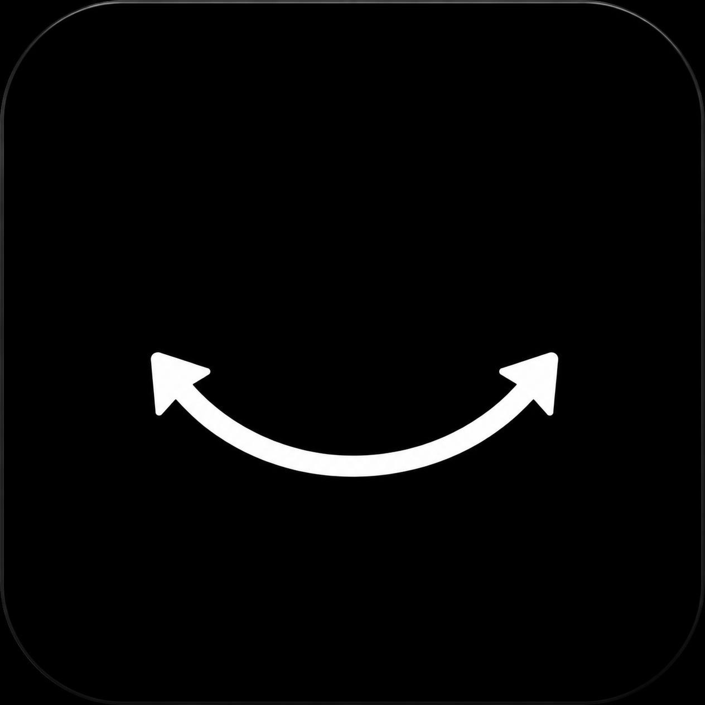
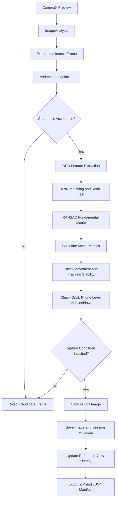

# PhotoAssistant
An Android-based photogrammetry capture assistant using OpenCV, ORB feature matching, and RANSAC-based geometric verification to help users capture sharp, geometrically consistent images for 3D reconstruction.

PhotoAssistant is an experimental Android application designed to help users capture a useful sequence of photographs for 3D photogrammetry. It analyses live camera frames and combines image sharpness assessment, local feature matching, geometric verification, viewpoint-change analysis, and motion guidance to help determine when a new photograph may be useful.

> **Scope:** PhotoAssistant assists with image acquisition. It does not perform 3D reconstruction on the phone, and passing its checks does not guarantee a successful reconstruction.

<p align="center">
  
</p>

<h1 align="center">PhotoAssistant</h1>

<p align="center">
  An Android assistant for guided photogrammetry image acquisition.
</p>

## Table of Contents

- [Motivation and Project Story](#motivation-and-project-story)
- [Project Goals](#project-goals)
- [Features](#features)
- [System Architecture](#system-architecture)
- [Mathematical Foundations](#mathematical-foundations)
  - [1. Image Sharpness: Variance of Laplacian](#1-image-sharpness-variance-of-laplacian)
  - [2. Local Feature Extraction: ORB](#2-local-feature-extraction-orb)
  - [3. Feature Matching: KNN and Ratio Test](#3-feature-matching-knn-and-ratio-test)
  - [4. Geometric Verification: RANSAC and Epipolar Geometry](#4-geometric-verification-ransac-and-epipolar-geometry)
- [Capture Decision Logic](#capture-decision-logic)
- [Orbit and Phone-Level Guidance](#orbit-and-phone-level-guidance)
- [Session Management and Export](#session-management-and-export)
- [Technology Stack](#technology-stack)
- [Experimental Parameters](#experimental-parameters)
- [Limitations](#limitations)
- [Future Work](#future-work)
- [Building and Running](#building-and-running)
- [References](#references)
- [License](#license)

---

## Motivation and Project Story

Photogrammetry reconstructs three-dimensional scenes from overlapping photographs. However, collecting a large number of images does not automatically produce a good reconstruction dataset. Blurred images, insufficient overlap, redundant viewpoints, and inconsistent camera movement can make the reconstruction process more difficult.

The idea behind PhotoAssistant emerged while studying **Image Analysis and Computer Vision**. After completing a course project under Professor Arrigoni's supervision, I wanted to continue exploring the concepts I had learned and apply them to a practical computer-vision application.

The initial idea was simple: could a smartphone help users decide when they should take a photograph while moving around an object?

I started by implementing **Variance of Laplacian**, a lightweight image-sharpness measure that can help identify potentially blurred frames. However, sharpness alone cannot determine whether a photograph contributes a useful new viewpoint. A sharp image may still be redundant, or it may not contain enough reliable visual correspondences with previous images.

To address this, I progressively extended the pipeline:

1. **Variance of Laplacian** provides a computationally inexpensive sharpness estimate.
2. **ORB** extracts distinctive local keypoints and binary descriptors from image frames.
3. **K-nearest-neighbour (KNN) matching** and a ratio test filter ambiguous feature correspondences.
4. **RANSAC-based Fundamental Matrix estimation** evaluates the geometric consistency of the remaining matches.
5. **Capture decision logic** combines these signals with image-plane displacement, tracking stability, cooldown timing, and previously accepted views.
6. **Orbit and phone-orientation guidance** helps users maintain a more consistent capture trajectory.

This progression transformed a simple sharpness checker into a multi-stage image-acquisition assistant.

The project explores how classical computer-vision techniques can support photogrammetry data collection directly on a mobile device. It is intended to complement, rather than replace, downstream 3D reconstruction software.

## Project Goals

- Assess the sharpness of live camera frames.
- Extract distinctive visual features efficiently.
- Establish correspondences between different viewpoints.
- Reject geometrically inconsistent feature matches.
- Reduce unnecessary or excessively frequent captures.
- Encourage useful viewpoint changes while moving around an object.
- Provide approximate phone-orientation and orbit guidance.
- Save captured images and export a portable scan dataset for downstream processing.

## Features

- Live camera preview and frame analysis using CameraX.
- Lightweight sharpness estimation from the luminance plane.
- ORB keypoint and binary-descriptor extraction with OpenCV.
- Hamming-distance feature matching.
- KNN matching with a ratio test.
- RANSAC-based Fundamental Matrix estimation.
- Inlier counting and inlier-ratio analysis.
- Image-plane feature-displacement checks.
- Stable-tracking and capture-cooldown conditions.
- A history of accepted viewpoints to help reduce redundant captures.
- Approximate orbit-progress and phone-level guidance using orientation sensors.
- Scan-session management, cancellation, and project deletion.
- ZIP export containing captured images and a JSON manifest.

## System Architecture

PhotoAssistant separates continuous camera-frame analysis from still-image capture.



The main components are:

1. **CameraX Preview:** displays the live camera feed.
2. **ImageAnalysis:** provides frames in `YUV_420_888` format using a latest-frame strategy.
3. **Image-quality analysis:** evaluates sharpness using the luminance plane.
4. **Feature extraction and matching:** detects ORB features and matches their descriptors.
5. **Geometric verification:** uses RANSAC to estimate the Fundamental Matrix and identify inliers.
6. **Capture decision logic:** combines image-quality, tracking, motion, stability, and viewpoint-history signals.
7. **ImageCapture:** captures a still photograph when the applicable conditions are satisfied.
8. **Session management:** stores photographs and metadata and provides ZIP export.

The feature reference is obtained from the live analysis stream so that feature comparisons use a consistent source and coordinate system. The full-resolution still photograph is captured separately for later use.

<p align="center">
  
</p>

## Mathematical Foundations

### 1. Image Sharpness: Variance of Laplacian

Image blur generally suppresses high-frequency details and weakens many local intensity transitions. The Laplacian operator measures second-order spatial intensity changes, making its variance a useful computationally inexpensive sharpness heuristic.

For a grayscale image \(I(x,y)\), the continuous Laplacian is

$$
\nabla^2 I(x,y)
=
\frac{\partial^2 I}{\partial x^2}
+
\frac{\partial^2 I}{\partial y^2}.
$$

In the implementation, a discrete four-neighbour stencil is evaluated using sampling step $s$:

$$
L_s(x,y)
=
I(x-s,y)+I(x+s,y)
+I(x,y-s)+I(x,y+s)
-4I(x,y).
$$

Let $L_1,L_2,\ldots,L_N$ denote the sampled Laplacian responses. Their mean is

$$
\bar L = \frac{1}{N}\sum_{i=1}^{N}L_i,
$$

and their variance is

$$
V_{\mathrm{Lap}}
=
\frac{1}{N}
\sum_{i=1}^{N}(L_i-\bar L)^2.
$$

The implementation uses the equivalent computational expression

$$
V_{\mathrm{Lap}}
=
\frac{1}{N}\sum_{i=1}^{N}L_i^2-\bar L^2.
$$

The live luminance frame is sampled to reduce computational cost. The sampling step depends on the frame dimensions.

**Interpretation:** a higher variance often indicates stronger local intensity changes and more visible detail, while a low variance may indicate blur.

However, this is a heuristic rather than a universal blur detector. Texture, sensor noise, exposure, resolution, and camera characteristics all affect the result. The threshold must therefore be calibrated for the intended device and capture conditions.

### 2. Local Feature Extraction: ORB

ORB combines FAST keypoint detection with an oriented BRIEF-style binary descriptor.

A keypoint represents a distinctive location in an image. Its descriptor encodes local intensity-comparison information around that point. ORB is suitable for mobile applications because it is relatively efficient and produces binary descriptors that can be compared using Hamming distance.

Let two binary descriptors be

\[
\mathbf a,\mathbf b\in\{0,1\}^{n}.
\]

Their Hamming distance is

\[
D_H(\mathbf a,\mathbf b)
=
\sum_{j=1}^{n}[a_j\ne b_j],
\]

where the bracket evaluates to \(1\) if the bits differ and \(0\) otherwise.

A smaller distance indicates more similar descriptors. Nevertheless, descriptor similarity alone does not prove that two keypoints represent the same physical scene point.

The current implementation requests up to **500 ORB features per frame**. The actual number depends on the image content.

### 3. Feature Matching: KNN and Ratio Test

After extracting ORB descriptors from two views, the application matches them using a brute-force matcher and K-nearest-neighbour search with \(k=2\).

For a descriptor in the reference image, let \(d_1\) and \(d_2\) denote the distances to its first and second nearest candidates, respectively, where \(d_1\le d_2\).

The ratio test retains a candidate when

\[
\frac{d_1}{d_2}<\tau,
\]

where \(\tau\) is the ratio threshold. The current experimental value is

\[
\tau=0.75.
\]

The intuition is that a reliable match should be noticeably better than the alternative candidate. If both candidates have similar distances, the correspondence is more ambiguous.

The ratio test reduces ambiguous matches, but false correspondences may remain. Geometric verification is therefore performed in the next stage.

### 4. Geometric Verification: RANSAC and Epipolar Geometry

Feature similarity does not guarantee geometric consistency. For two views of a scene, corresponding points should approximately satisfy the epipolar constraint.

Let \(\mathbf{x}\) and \(\mathbf{x}'\) be corresponding points in homogeneous image coordinates. Then

\[
\mathbf{x}'^{T}F\mathbf{x}=0,
\]

where \(F\) is the **Fundamental Matrix** describing the epipolar geometry between the two views.

The equation expresses the fact that a point in one image constrains its corresponding point in the other image to lie on an epipolar line.

PhotoAssistant uses OpenCV's RANSAC-based Fundamental Matrix estimation to identify correspondences that agree with a common geometric model.

RANSAC follows an iterative process:

1. Select a subset of matched point correspondences.
2. Estimate a candidate geometric model.
3. Evaluate the consistency of the remaining correspondences with that model.
4. Separate the correspondences into inliers and outliers.
5. Repeat the process and retain a suitable model according to the estimator's scoring procedure.

An **inlier** is a correspondence accepted as consistent with the estimated model. An **outlier** is rejected as inconsistent.

If \(N_{\mathrm{inlier}}\) is the number of inliers and \(N_{\mathrm{good\ matches}}\) is the number of ratio-filtered matches, the inlier ratio is

\[
r_{\mathrm{inlier}}
=
\frac{N_{\mathrm{inlier}}}
{N_{\mathrm{good\ matches}}}.
\]

The inlier count and ratio provide complementary information about geometric consistency.

<p align="center">
  
</p>

**Important distinction:** a high inlier count does not necessarily indicate a useful new viewpoint. Nearly identical images may also produce many geometrically consistent matches. PhotoAssistant therefore combines geometric consistency with movement and previously accepted-view information.

## Capture Decision Logic

PhotoAssistant does not rely on a single metric. A frame may be sharp but redundant, or it may contain many feature matches that are geometrically inconsistent.

The application combines several signals:

| Signal | Purpose |
|---|---|
| Laplacian variance | Estimate image sharpness |
| Good KNN matches | Measure the number of ratio-filtered correspondences |
| RANSAC inliers | Count geometrically consistent correspondences |
| Inlier ratio | Measure the fraction of good matches accepted as inliers |
| Average inlier displacement | Estimate movement of matched points in image coordinates |
| Tracking stability | Avoid acting on unstable tracking results |
| Capture cooldown | Prevent captures from occurring too frequently |
| Viewpoint history | Help identify potentially redundant views |
| Orientation and orbit checks | Provide approximate movement guidance |

The general decision process is:

1. Initialise the reference view using a live analysis frame.
2. Evaluate the sharpness of subsequent frames.
3. Extract ORB keypoints and descriptors.
4. Match descriptors using KNN and the ratio test.
5. Estimate geometric consistency using RANSAC.
6. Evaluate the resulting match metrics.
7. Apply the relevant stability, displacement, cooldown, and orientation checks.
8. Compare the candidate with previously accepted views.
9. Capture a still image if the applicable conditions are satisfied.
10. Update the reference-view history and session metadata.

### Average Feature Displacement

For \(M\) accepted inlier correspondences, let \(\mathbf p_i=(x_i,y_i)\) and \(\mathbf p'_i=(x'_i,y'_i)\) represent matched keypoint coordinates in the two images.

The average displacement is

\[
D_{\mathrm{avg}}
=
\frac{1}{M}
\sum_{i=1}^{M}
\sqrt{(x'_i-x_i)^2+(y'_i-y_i)^2}.
\]

This value measures average image-plane displacement of matched points.

It is **not** a direct estimate of camera translation, camera rotation, physical distance, or 3D motion. Its value depends on image resolution, scene geometry, and the camera's movement.

The displacement threshold is therefore an empirical capture parameter rather than a calibrated physical quantity.

## Orbit and Phone-Level Guidance

When the rotation-vector sensor is available, PhotoAssistant estimates accumulated yaw change and uses it to provide approximate guidance while the user moves around an object.

The orbit logic tracks the approximate direction of rotation, warns about sustained reverse movement, and checks progress toward a nearly complete orbit.

The current experimental settings include:

| Parameter | Value |
|---|---:|
| Reverse-motion warning threshold | `18°` |
| Near-complete orbit threshold | `300°` |
| Return-to-start tolerance | `25°` |
| Maximum pitch drift | `14°` |
| Maximum roll drift | `16°` |
| Consecutive checked frames before a level warning | `4` |

The phone-level guard compares pitch and roll against their initial values at the start of a scan.

**It does not directly measure physical camera height.** Orientation sensors provide information about device orientation, not absolute position. Estimating actual height or a full camera trajectory would require additional techniques, such as visual-inertial odometry, depth sensing, or an appropriate motion-estimation system.

Sensor-based orbit progress is approximate and may be affected by noise, the way the phone is held, and movement relative to the object. It should be treated as user guidance rather than ground-truth camera-pose estimation.

## Session Management and Export

PhotoAssistant organises captured photographs into scan sessions.

The session records metadata such as:

- Image filename.
- Capture timestamp.
- Whether the image is the initial reference photograph.

When the user finishes a scan, the application can package the accepted photographs and a `manifest.json` file into a ZIP archive for transfer to a desktop reconstruction workflow.

Example manifest structure:

```json
{
  "application": "PhotoAssistant",
  "sessionFolder": "Scan_YYYYMMDD_HHMMSS",
  "createdAt": 0,
  "photoCount": 1,
  "photos": [
    {
      "fileName": "example.jpg",
      "capturedAtMillis": 0,
      "isInitialReference": true
    }
  ],
  "notes": "Illustrative example; timestamps are Unix epoch milliseconds."
}
```

The values above are placeholders for documentation purposes, not results from an actual scan.

PhotoAssistant focuses on image acquisition and dataset organisation. The exported images can be passed to a separate photogrammetry or 3D reconstruction tool.

## Technology Stack

- **Kotlin** — application logic.
- **Jetpack Compose** — user interface.
- **CameraX** — camera preview, frame analysis, and still-image capture.
- **OpenCV for Android** — ORB features, Hamming-distance matching, and RANSAC-based Fundamental Matrix estimation.
- **Android rotation-vector sensor** — approximate phone-orientation and orbit guidance.
- **Android file and archive APIs** — session storage, ZIP export, and JSON metadata.

## Experimental Parameters

The following values describe the current development configuration. They are experimental settings, not universally optimal thresholds.

| Parameter | Value |
|---|---:|
| ORB feature budget | `500` |
| KNN ratio threshold | `0.75` |
| Minimum Laplacian variance | `35.0` |
| Minimum good matches | `15` |
| Minimum RANSAC inliers | `10` |
| Minimum inlier ratio | `0.30` |
| Minimum average inlier displacement | `55 px` |
| Capture cooldown | `3000 ms` |
| Stable tracking requirement | `5` frames |
| Duplicate-view movement threshold | `50 px` |

These parameters should be evaluated through repeatable experiments across different objects, devices, lighting conditions, and camera movements before being described as generally optimal.

## Limitations

- Variance of Laplacian is affected by texture, noise, exposure, resolution, and camera hardware.
- ORB feature matching may struggle with textureless, reflective, repetitive, or strongly changing surfaces.
- RANSAC can reject inconsistent correspondences, but a valid Fundamental Matrix does not prove that a view is useful or sufficiently novel.
- Average pixel displacement is not a calibrated camera-motion estimate.
- Duplicate-view detection is heuristic; it is not a complete loop-closure or 3D pose-estimation system.
- Rotation-vector data provides orientation, not absolute position or physical height.
- The application does not reconstruct meshes, point clouds, NeRFs, or Gaussian Splatting scenes.
- No device-independent threshold calibration or formal quantitative benchmark is claimed in this README.
- Passing all capture checks does not guarantee successful downstream reconstruction.

## Future Work

- Build a repeatable evaluation dataset containing sharp and blurred frames and controlled viewpoint changes.
- Measure false acceptance and false rejection rates for the capture decision logic.
- Evaluate accepted image sets using a downstream photogrammetry pipeline.
- Report reconstruction quality and completeness using appropriate quantitative metrics.
- Calibrate thresholds for camera hardware, resolution, lighting, and object type.
- Improve duplicate-view detection using geometric models and estimated camera poses.
- Explore ARCore or visual-inertial odometry for more robust spatial guidance.
- Add capture-coverage visualisation and richer scan-session diagnostics.

## Building and Running

The exact build instructions should match the final Android Studio project and dependency configuration.

Before publishing, ensure that the repository includes the complete project structure, including:

- Gradle wrapper and build files.
- Version catalog, if used.
- Android manifest and resources.
- Kotlin source files.
- OpenCV Android dependency configuration.
- Any required icons and documentation assets.

General setup:

1. Install a compatible version of Android Studio and the Android SDK.
2. Clone the repository.
3. Open the project root in Android Studio.
4. Allow Gradle synchronisation to complete.
5. Verify that the OpenCV dependency is configured correctly.
6. Run the application on an Android device with camera permission granted.

A physical device is recommended for testing CameraX and rotation-sensor behaviour. Exact SDK levels and dependency versions should be documented from the final Gradle configuration.

## References

1. Rublee, E., Rabaud, V., Konolige, K., and Bradski, G. (2011). **ORB: An efficient alternative to SIFT or SURF.** *2011 International Conference on Computer Vision (ICCV).* https://doi.org/10.1109/ICCV.2011.6126544
2. Fischler, M. A., and Bolles, R. C. (1981). **Random Sample Consensus: A Paradigm for Model Fitting with Applications to Image Analysis and Automated Cartography.** *Communications of the ACM, 24*(6), 381–395. https://doi.org/10.1145/358669.358692
3. Hartley, R., and Zisserman, A. **Multiple View Geometry in Computer Vision.** 2nd edition, Cambridge University Press, 2004.
4. OpenCV documentation: https://docs.opencv.org/
5. Android CameraX documentation: https://developer.android.com/media/camera/camerax

## License

PhotoAssistant is intended to be released as an open-source project. If the MIT License is selected, add the complete MIT License text in a `LICENSE` file at the repository root and replace the copyright placeholder with the copyright holder's name.

Before publishing, verify compatibility with the licenses of all third-party dependencies and assets.

---

**Author:** Pourya Shabazzadeh  
**Institution:** Politecnico di Milano  
**Project status:** Experimental / under active development
